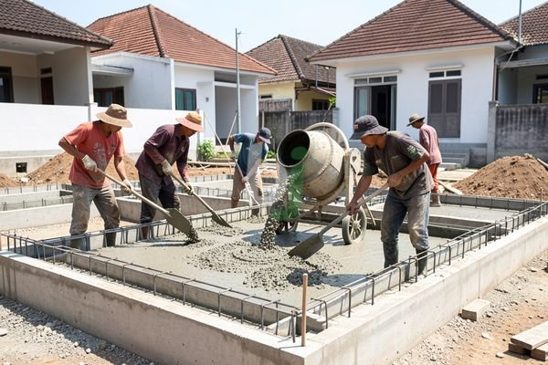

**Berapa Biaya Cor Rumah Per M2 di Jabodetabek?** - Hai Mitra Beton Jago! Punya rencana membangun rumah di Jabodetabek? Memperkirakan biaya cor rumah per meter persegi adalah langkah awal yang cerdas. Biaya ini bisa bervariasi, tergantung mutu beton yang dipilih, ketebalan cor, dan lokasi spesifik proyek Anda di wilayah Jabodetabek. Yuk, kita bahas lebih detail!

## Apa Saja yang Mempengaruhi Biaya Cor Rumah Per M2?

Biaya cor rumah per m2 itu nggak cuma soal harga beton, lho. Ada beberapa faktor utama yang perlu Anda perhatikan. Pertama dan terpenting adalah mutu beton. Semakin tinggi mutu beton (misalnya K-300, K-350, atau K-400), harganya juga akan meningkat. Mutu beton ini ditentukan oleh komposisi campuran semen, pasir, kerikil, dan air. Semakin tinggi mutunya, semakin kuat dan tahan lama beton tersebut – yang tentunya berdampak pada harga.

Selain mutu, ketebalan cor juga berperan penting. Ketebalan cor disesuaikan dengan kebutuhan struktural bangunan. Pondasi biasanya membutuhkan cor yang lebih tebal daripada lantai, misalnya. Semakin tebal cor yang diperlukan, semakin banyak material yang dipakai dan semakin besar biayanya.

Terakhir, jangan lupakan lokasi proyek di Jabodetabek. Biaya transportasi material beton readymix dari pabrik ke lokasi proyek akan berbeda tergantung jarak dan kondisi lalu lintas. Daerah yang sulit dijangkau juga bisa menambah biaya karena membutuhkan waktu dan tenaga ekstra untuk pengiriman dan pengerjaan.

## Estimasi Biaya Cor Rumah Per M2 di Jabodetabek Tahun 2026

Nah, untuk memberikan gambaran yang lebih jelas, ini dia estimasi biaya cor rumah per m2 di Jabodetabek pada tahun 2026. Perlu diingat bahwa angka ini bersifat indikatif dan bisa berubah sewaktu-waktu, tergantung fluktuasi pasar dan kesepakatan harga dengan penyedia jasa.

| Jenis Cor | Mutu Beton | Ketebalan (cm) | Estimasi Biaya Per M2 (Rp) |
|---|---|---|---|
| Pondasi | K-300 | 30 | 450.000 – 600.000 |
| Sloof | K-300 | 20 | 350.000 – 500.000 |
| Kolom | K-300 | 20 | 400.000 – 550.000 |
| Balok | K-300 | 20 | 380.000 – 530.000 |
| Lantai | K-250 | 10 | 300.000 – 450.000 |

Harga ini hanya perkiraan, ya. Untuk mendapatkan penawaran harga terbaru dan paling akurat sesuai kebutuhan proyek Anda, hubungi Kami sekarang juga!

## Memilih Penyedia Jasa Pengecoran yang Terpercaya

Harga memang penting, tapi jangan sampai mengorbankan kualitas! Memilih penyedia jasa pengecoran yang tepat adalah kunci untuk memastikan kekuatan dan ketahanan bangunan Anda, terutama dengan memahami [proses cor bangunan rumah](/blog/cor-bangunan-rumah/). Pastikan penyedia jasa memiliki reputasi baik, pengalaman yang cukup, dan tenaga kerja yang profesional. Perhatikan juga apakah mereka menawarkan layanan lengkap, mulai dari pengadaan material beton readymix, pemasangan besi, hingga proses pengecoran itu sendiri.

Di Beton Jago, kami hadir sebagai solusi lengkap untuk kebutuhan pengecoran Anda di wilayah Jabodetabek! [Pelajari lebih lanjut tentang cara membuat rumah cor](/blog/cara-membuat-rumah-cor/) Kami menyediakan beton readymix berkualitas tinggi, layanan sewa *concrete pump*, dan jasa pengecoran profesional. Kami berkomitmen untuk memberikan layanan terbaik dengan harga yang kompetitif. Kalau Anda tertarik untuk tahu lebih banyak tentang [campuran cor dak rumah untuk kekuatan bangunan maksimal](https://betonjago.com/blog/campuran-cor-dak-rumah/), silakan kunjungi artikel Kami yang lain.

## Tips Hemat Biaya Cor Rumah

Ingin menghemat biaya cor rumah? Tentu bisa! Ini dia beberapa tips yang bisa Anda terapkan:

*   **Rencanakan anggaran dengan matang:** Bandingkan harga dari beberapa penyedia jasa sebelum memutuskan.
*   **Pilih mutu beton yang tepat:** Sesuaikan mutu beton dengan kebutuhan struktural bangunan. Tidak selalu mutu tertinggi yang terbaik.
*   **Optimalkan penggunaan material:** Lakukan perhitungan yang akurat untuk meminimalkan pemborosan.
*   **Pertimbangkan alternatif:** Penggunaan dak hebel bisa menjadi solusi untuk mengurangi beban struktur bangunan dan biaya cor.

Butuh bantuan langsung untuk proyek Anda? Jangan ragu untuk menghubungi Kami! Klik tombol **WhatsApp** atau **Telepon** di bawah untuk berkonsultasi dengan tim Kami. Kami siap membantu Anda!