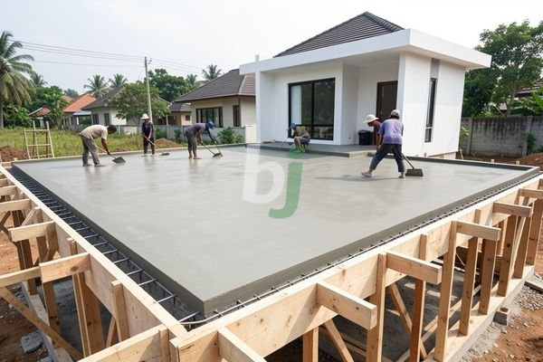

**Cor Dak Minimalis Jangan Sampai Salah Perhitungan Struktur** - Hai Mitra Beton Jago! Lagi mikirin desain minimalis untuk rumah impian? Nah, salah satu elemen yang lagi populer banget adalah dak beton minimalis. Estetikanya memang juara, tapi jangan sampai salah perhitungan struktur ya!

Desain minimalis memang sedang jadi primadona, dan cor dak minimalis adalah salah satu cara keren untuk mewujudkannya. Tapi ingat, Mitra! Keindahan tanpa kekuatan itu kurang lengkap. Jadi, yuk kita kupas tuntas apa saja yang perlu diperhatikan agar cor dak minimalis Anda kuat, aman, dan tahan lama.

## Keunggulan Cor Dak Minimalis: Kenapa Pilih Beton?

Mengapa memilih cor dak minimalis dibandingkan opsi lain? Banyak alasannya! Pertama, kekuatan dan daya tahannya sudah teruji. Beton, apalagi yang memenuhi standar SNI, mampu menahan beban dengan sangat baik. Kedua, perawatan dak beton minimalis terbilang mudah dan cepat, lho. Material ini juga punya umur pakai yang panjang, jadi nggak perlu khawatir sering-sering renovasi.

Coba bandingkan dengan material kayu. Kayu memang terlihat natural, tapi rentan dimakan rayap dan cepat lapuk kalau nggak dirawat rutin. Bahkan, umurnya pun nggak sepanjang beton. Kalau baja ringan? Walaupun ringan, ada risiko karat jika lapisan pelindungnya rusak. Nah, dengan cor dak minimalis, Mitra Beton Jago bisa dapat kokohnya beton dengan tampilan modern yang diinginkan.

## Perencanaan Matang: Kunci Sukses Cor Dak Minimalis

Jangan asal cor! Perencanaan yang matang itu penting banget, Mitra. Pastikan Anda menggunakan jasa tenaga ahli yang kompeten untuk mendesain struktur dak. Mereka akan menghitung beban mati (berat bangunan) dan beban hidup (aktivitas, perabot, kemungkinan beban tambahan) dengan cermat. 

Ketebalan dak beton minimal yang aman adalah 120 mm untuk bentang yang nggak terlalu lebar. Kalau bentangnya lebih panjang, sebaiknya ditingkatkan jadi 150 mm atau lebih – tergantung hasil perhitungan struktur. Mutu beton juga jangan sembarangan dipilih. Kami sarankan menggunakan beton mutu K-250 atau K-300 untuk performa yang optimal.

## Estimasi Biaya Cor Dak Minimalis: Berapa Sih?

Soal biaya, cor dak minimalis bisa bervariasi tergantung luas area, ketebalan dak, mutu beton, dan harga material di (not detected). Secara umum, biaya per meter persegi bisa berkisar antara Rp 350.000 hingga Rp 600.000. Tapi ingat, ini cuma estimasi ya, Mitra! Untuk mendapatkan penawaran paling akurat sesuai proyek Anda, segera hubungi Kami.

Sebagai gambaran kasar, anggap saja Anda mau membuat dak ukuran 4x6 meter dengan ketebalan 120 mm dan mutu beton K-300:

*   Luas dak: 4 m x 6 m = 24 m²
*   Biaya per meter persegi (perkiraan): Rp 450.000
*   Total biaya: 24 m² x Rp 450.000 = Rp 10.800.000

Nah, angka segitu belum termasuk biaya besi, pengiriman beton readymix, dan upah tukang. Untuk rincian lengkapnya, langsung aja konsultasikan proyek Anda dengan Kami! [Bangunan Dak Cor: Panduan Lengkap Material, Proses, dan Biaya di 2026](/blog/bangunan-dak-cor/) bisa jadi referensi tambahan, lho.

Butuh informasi lebih lanjut? Jangan sungkan menghubungi Kami melalui tombol **WhatsApp** atau **Telepon** yang ada di halaman ini. Kami siap membantu mewujudkan dak minimalis impian Mitra Beton Jago di (not detected)!