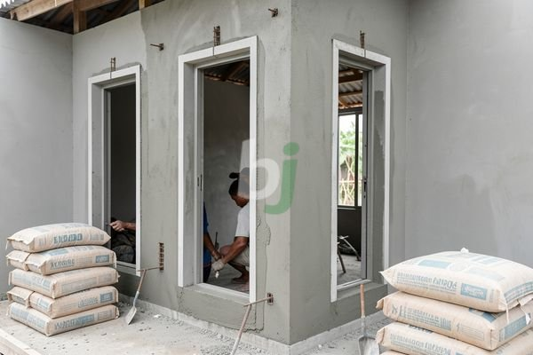

**Kusen cor beton untuk rumah minimalis yang kuat dan estetik** - Hai Mitra Beton Jago! Sedang merencanakan tampilan rumah minimalis impian di (not detected)? Kusen adalah detail penting yang seringkali terlupakan. Lebih dari sekadar bingkai pintu dan jendela, kusen berperan krusial dalam menentukan karakter bangunan dan kekuatan strukturnya. Yuk, simak kenapa kusen cor beton bisa jadi pilihan cerdas!

## Kenapa Kusen Cor Beton Jadi Pilihan Tepat?

Kusen cor beton makin digemari, khususnya untuk desain rumah modern dan minimalis. Apa alasannya? Sederhana saja: kekuatan dan keawetan yang tak tertandingi. Beton mampu menahan beban lebih besar dibandingkan material lain, seperti kayu atau aluminium. Plus, beton tahan terhadap segala cuaca ekstrem. Ini berarti, kusen Anda tidak mudah melengkung, retak, atau membusuk.

Bukan cuma kuat, kusen cor beton juga memberikan kesan kokoh dan mewah pada rumah Anda. Material ini juga relatif mudah dirawat, Anda tidak perlu repot mengecat ulang secara berkala. Fleksibilitas desain juga menjadi nilai tambah. Dari desain simpel hingga rumit, kusen cor beton bisa dibentuk sesuai imajinasi Anda. Bayangkan, rumah Anda bisa tampil unik dan personal!

## Langkah-Langkah Pemasangan Kusen Cor Beton yang Benar

Memasang kusen cor beton membutuhkan ketelitian. Supaya hasilnya optimal, perhatikan langkah-langkah berikut:

1.  **Persiapan Bekisting:** Bekisting, atau cetakan kusen, harus kuat dan kedap air. Pastikan perakitannya rapat agar tidak ada adukan beton yang bocor.
2.  **Pemasangan Tulangan:** Tulangan besi berfungsi memperkuat struktur kusen. Pasang sesuai desain struktur yang sudah direncanakan. Perhatikan jarak dan diameter tulangan, sesuai standar yang berlaku.
3.  **Pengecoran Beton:** Gunakan beton *ready mix* berkualitas, sesuai kebutuhan proyek Anda. Kami di Beton Jago menyediakan berbagai pilihan mutu beton *ready mix* yang bisa disesuaikan. Pastikan beton tercampur rata lalu dituangkan ke bekisting secara merata, hilangkan risiko rongga atau cacat.
4.  **Perawatan Beton:** Setelah beton mengeras, siram air secara rutin selama beberapa hari. Ini mencegah retak akibat penguapan air yang terlalu cepat.

## Perkiraan Biaya Kusen Cor Beton di (not detected) dan Sekitarnya

Biaya pembuatan kusen cor beton dipengaruhi oleh beberapa faktor: ukuran kusen, kompleksitas desain, mutu beton yang digunakan, dan biaya tenaga kerja. Secara umum, harga di wilayah (not detected) berkisar antara Rp 350.000 hingga Rp 750.000 per meter persegi. Harga ini adalah estimasi dan bisa berubah — hubungi Kami untuk penawaran harga paling akurat sesuai kebutuhan proyek Anda.

Sebagai gambaran, mari menghitung estimasi biaya untuk kusen berukuran 1 meter x 2 meter dan tebal 15 cm. Asumsikan harga beton *ready mix* Rp 800.000 per meter kubik dan biaya tenaga kerja Rp 100.000 per meter persegi.

*   Volume beton yang dibutuhkan: 1 m x 2 m x 0.15 m = 0.3 m³
*   Biaya beton: 0.3 m³ x Rp 800.000/m³ = Rp 240.000
*   Biaya tenaga kerja: 2 m² x Rp 100.000/m² = Rp 200.000
*   Total biaya: Rp 240.000 + Rp 200.000 = Rp 440.000

Jadi, estimasi biaya pembuatan kusen berukuran tersebut sekitar Rp 440.000.

## Kusen Cor Beton vs. Material Lain: Mana yang Terbaik untuk Anda?

Bingung memilih antara kusen cor beton dengan material lain? Berikut tabel perbandingan yang bisa membantu:

<table class="table">
  <caption>Perbandingan Kusen</caption>
  <thead>
    <tr><th>Material</th><th>Kekuatan</th><th>Daya Tahan</th><th>Biaya</th><th>Perawatan</th></tr>
  </thead>
  <tbody>
    <tr><td>Cor Beton</td><td>Sangat Kuat</td><td>Sangat Tahan Lama</td><td>Sedang</td><td>Minim</td></tr>
    <tr><td>Kayu</td><td>Cukup Kuat</td><td>Cukup Tahan Lama</td><td>Sedang - Tinggi</td><td>Berkala</td></tr>
    <tr><td>Aluminium</td><td>Kuat</td><td>Tahan Lama</td><td>Tinggi</td><td>Minim</td></tr>
  </tbody>
</table>

Dengan mempertimbangkan keunggulan dan kelemahan masing-masing material, Anda bisa memilih yang paling sesuai dengan kebutuhan dan anggaran Anda. Jika Anda mengutamakan kekuatan, daya tahan, dan tampilan yang kokoh, kusen cor beton adalah solusi yang tepat.

Butuh informasi lebih lanjut? Jangan ragu untuk menghubungi Kami! Tombol **Telepon** dan **WhatsApp** di bawah ini siap membantu Anda.  [Cara cor rumah benar Beton Jago](/blog/cara-cor-rumah/) — pelajari juga panduan lengkap untuk pengecoran rumah yang benar. Kami siap mendukung proyek Anda di (not detected) dan sekitarnya!