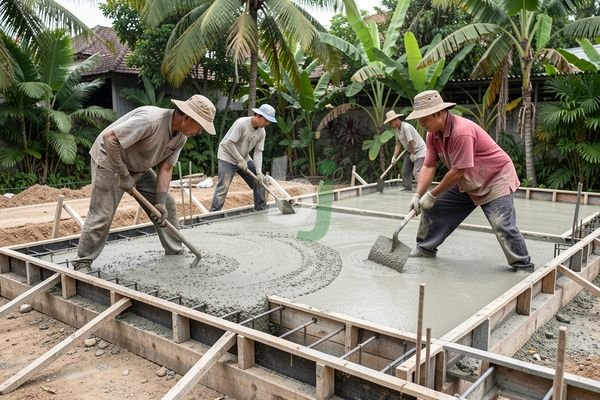

**Bagaimana Cara Membuat Dak Rumah yang Kuat dan Tahan Lama?** - Mitra Beton Jago yang budiman, tahukah Mitra bahwa sekitar 60% kegagalan struktur bangunan berasal dari perencanaan dan pelaksanaan dak yang kurang tepat? Angka ini menunjukkan betapa krusialnya pemahaman yang benar mengenai proses pembuatan dak rumah agar investasi properti Mitra tetap aman dan bernilai jangka panjang. Kami akan memandu Mitra melalui langkah-langkah penting dalam membuat dak rumah yang kokoh dan sesuai standar.

## Memahami Fungsi dan Jenis Dak Rumah

Dak rumah berfungsi sebagai penutup atas suatu bangunan, sekaligus menjadi lantai untuk area di atasnya. Fungsi utama dak adalah menerima beban hidup (misalnya orang, perabot) dan beban mati (material bangunan itu sendiri). Selain itu, dak juga berperan penting dalam menahan cuaca ekstrem seperti panas, hujan, dan angin. 

Ada beberapa jenis dak rumah yang umum digunakan, di antaranya:

*   **Dak Beton Bertulang:** Jenis yang paling umum digunakan karena kuat, tahan lama, dan relatif ekonomis.
*   **Dak Baja Ringan:** Lebih ringan dari beton bertulang, cocok untuk bangunan dengan struktur yang tidak mampu menahan beban berat.
*   **Dak Kayu:** Pilihan tradisional yang semakin jarang digunakan karena rentan terhadap rayap dan kebakaran.

Pemilihan jenis dak harus disesuaikan dengan kebutuhan bangunan, anggaran, dan kondisi lingkungan. Untuk bangunan residensial dengan beban standar, dak beton bertulang seringkali menjadi pilihan terbaik.

## Proses Pembuatan Dak Rumah Beton Bertulang

Proses pembuatan dak beton bertulang melibatkan beberapa tahapan penting. Pertama, persiapan bekisting atau cetakan dak. Bekisting harus kuat dan presisi agar membentuk dak dengan dimensi yang sesuai. Material bekisting yang umum digunakan adalah kayu atau baja. Setelah bekisting terpasang, langkah selanjutnya adalah pemasangan tulangan baja. Tulangan berfungsi untuk menahan gaya tarik pada beton. Jarak antar tulangan dan diameter tulangan harus sesuai dengan perhitungan struktur.

Setelah pemasangan tulangan selesai, barulah proses pengecoran beton. Kami sangat merekomendasikan penggunaan *concrete pump* untuk memastikan beton tercampur rata dan terdistribusi merata ke seluruh area dak. Beton yang digunakan sebaiknya memiliki mutu minimal K-250, sesuai standar SNI. Setelah beton mengeras, bekisting dapat dibongkar dan proses finishing dapat dimulai.

## Estimasi Biaya Membuat Dak Rumah di Jabodetabek

Biaya pembuatan dak rumah bervariasi tergantung pada beberapa faktor, seperti luas area, jenis dak, mutu beton, dan harga material. Sebagai gambaran, berikut adalah estimasi biaya pembuatan dak beton bertulang di wilayah Jabodetabek pada tahun 2026:

| Komponen Biaya          | Estimasi Biaya (Rp/m²) |
| ------------------------ | ---------------------- |
| Bahan (Beton, Tulangan) | 350.000 - 500.000      |
| Bekisting                | 50.000 - 100.000       |
| Tenaga Kerja             | 150.000 - 250.000      |
| Biaya Lain-lain          | 20.000 - 50.000        |
| **Total Estimasi**       | **570.000 - 900.000**    |

Harga ini bersifat estimasi dan dapat berubah sewaktu-waktu — hubungi Kami untuk penawaran terbaru dan paling akurat sesuai kebutuhan proyek Mitra Beton Jago. Angka tersebut belum termasuk biaya *concrete pump* jika diperlukan, yang biasanya dihitung per jam atau per meter kubik beton yang dipompa.

## Tips Memilih Jasa Pengecoran Dak Rumah Profesional

Memilih jasa pengecoran dak rumah yang profesional sangat penting untuk menjamin kualitas dan keamanan bangunan. Pastikan penyedia jasa memiliki pengalaman yang memadai, tenaga kerja yang terampil, dan peralatan yang lengkap. Selain itu, periksa apakah penyedia jasa tersebut memiliki reputasi yang baik dan dapat memberikan garansi atas pekerjaan yang dilakukan. Kami di Beton Jago siap membantu Mitra dalam menyediakan beton *readymix* berkualitas tinggi dan jasa pengecoran yang handal di wilayah Jabodetabek.

Apabila masih terdapat hal yang ingin ditanyakan, jangan ragu menghubungi Kami melalui tombol **WhatsApp** atau **Telepon** pada halaman ini.
