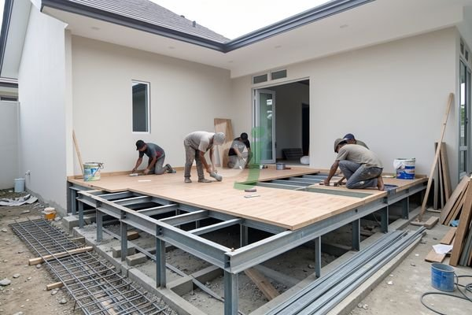

**Cara Meningkat Rumah Tanpa Cor Lebih Efisien di Jabodetabek** - Mitra Beton Jago yang kami hormati, seringkali kita menghadapi kebutuhan untuk menambah tinggi bangunan rumah. Mungkin untuk menambah kamar tidur, membuat ruang keluarga di lantai atas, atau sekadar menyesuaikan dengan kebutuhan keluarga yang berkembang. Namun, proses pengecoran seringkali dianggap rumit, memakan waktu, dan menimbulkan banyak debu serta gangguan. Pertanyaan yang kemudian muncul adalah: bisakah rumah ditingkatkan tanpa proses pengecoran yang konvensional?

Kami memahami kekhawatiran tersebut. Solusi untuk meningkatkan rumah tanpa cor memang ada, dan semakin populer karena kemudahan serta efisiensinya. Pada artikel ini, Kami akan membahas berbagai opsi yang tersedia, kelebihan dan kekurangannya, serta pertimbangan penting sebelum Mitra Beton Jago memutuskan langkah terbaik untuk proyek renovasi rumah.

## Pilihan Material Alternatif untuk Meningkatkan Rumah Tanpa Cor

Alternatif utama untuk meningkatkan rumah tanpa cor meliputi penggunaan material ringan seperti bata ringan (hebel), *sandwich panel*, dan rangka baja ringan. Masing-masing material menawarkan karakteristik yang berbeda dan cocok untuk jenis bangunan serta kebutuhan yang spesifik.

Bata ringan, misalnya, dikenal karena bobotnya yang ringan dan kemudahan dalam pemasangan. Material ini mengurangi beban struktur bangunan secara signifikan dibandingkan dengan penggunaan beton bertulang. Pemasangan bata ringan juga relatif cepat dan menghasilkan sedikit debu, sehingga lebih nyaman bagi penghuni rumah. Namun, kekuatan bata ringan relatif lebih rendah dibandingkan beton, sehingga memerlukan perencanaan struktur yang cermat.

Kemudian ada *sandwich panel* yang terdiri dari dua lapisan material (seperti plat baja atau cement board) dengan inti isolasi di antaranya. Panel ini menawarkan kekuatan yang baik, isolasi termal dan akustik yang unggul, serta kecepatan pemasangan yang tinggi. Namun, biaya *sandwich panel* cenderung lebih mahal daripada bata ringan.

Terakhir, rangka baja ringan yang dilapisi dengan material penutup seperti *gypsum board* atau *cement board* juga menjadi pilihan populer. Rangka baja ringan memiliki kekuatan yang tinggi dengan bobot yang ringan, tahan terhadap rayap, dan relatif mudah dipasang.

## Pertimbangan Struktural dalam Peningkatan Rumah Tanpa Cor

Meskipun material alternatif menawarkan kemudahan, Mitra Beton Jago perlu memahami bahwa setiap penambahan beban pada struktur bangunan memerlukan perhitungan yang matang. Jika pondasi rumah tidak dirancang untuk menahan beban tambahan, peningkatan rumah tanpa memperkuat struktur bawah dapat menimbulkan risiko yang serius.

Konsultasikan dengan ahli struktur bangunan untuk mengevaluasi kondisi pondasi dan struktur bangunan yang ada. Ahli struktur akan menentukan apakah pondasi perlu diperkuat atau dimodifikasi sebelum proses peningkatan dimulai. Perlu diingat, standar SNI yang berlaku untuk bangunan beton harus tetap menjadi acuan dalam perencanaan struktur, bahkan jika material yang digunakan bukan beton.

Perlu diperhatikan juga bahwa kemampuan material alternatif dalam menahan beban gempa perlu diperhitungkan, terutama jika wilayah tempat tinggal Mitra Beton Jago rawan gempa. Pastikan material yang dipilih memenuhi standar ketahanan gempa yang berlaku.

## Estimasi Biaya Meningkatkan Rumah Tanpa Cor

Biaya peningkatan rumah tanpa cor bervariasi tergantung pada material yang dipilih, luas bangunan, kompleksitas desain, dan lokasi. Sebagai gambaran, berikut adalah estimasi biaya per meter persegi (harga ini bersifat estimasi dan dapat berubah sewaktu-waktu — hubungi Kami untuk penawaran terbaru dan paling akurat sesuai kebutuhan proyek Mitra Beton Jago):

*   **Bata Ringan:** Rp 2.500.000 – Rp 3.500.000 per meter persegi (termasuk material dan upah kerja)
*   ***Sandwich Panel:*** Rp 3.500.000 – Rp 5.000.000 per meter persegi (termasuk material dan upah kerja)
*   **Rangka Baja Ringan + *Gypsum Board*:** Rp 2.000.000 – Rp 3.000.000 per meter persegi (termasuk material dan upah kerja)

Perlu diingat bahwa estimasi ini belum termasuk biaya desain, perizinan, dan biaya tak terduga lainnya. Untuk mendapatkan perhitungan biaya yang lebih akurat, Kami sarankan untuk meminta penawaran dari beberapa penyedia jasa renovasi terpercaya.

## Memastikan Keamanan dan Kualitas Peningkatan Rumah

Keamanan dan kualitas merupakan prioritas utama dalam peningkatan rumah, baik dengan metode cor konvensional maupun tanpa cor. Pastikan kontraktor yang dipilih memiliki pengalaman dan reputasi yang baik. Periksa juga apakah kontraktor memiliki izin usaha yang sah dan tenaga ahli yang kompeten.

Penting juga untuk mengawasi proses pekerjaan secara berkala untuk memastikan bahwa pekerjaan dilakukan sesuai dengan desain dan standar kualitas yang ditetapkan. Jangan ragu untuk bertanya kepada kontraktor jika Mitra Beton Jago memiliki pertanyaan atau kekhawatiran.

Tim Kami siap membantu mewujudkan proyek Mitra Beton Jago — silakan hubungi melalui tombol **Telepon** atau **WhatsApp** yang tersedia di bawah.
