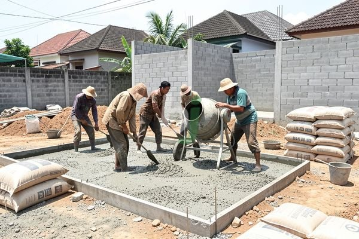

**Ngecor Rumah Murah** - Mitra Beton Jago yang berbahagia, seringkali kita mendengar kekhawatiran tentang biaya pengecoran rumah yang membengkak. Banyak pemilik rumah ragu memulai pembangunan karena tidak ingin anggaran habis di tahap fondasi. Kami memahami betul kekhawatiran Mitra, dan artikel ini hadir untuk memberikan panduan praktis agar pengecoran rumah Mitra bisa lebih efisien dan terjangkau.

## Merencanakan Pengecoran Rumah: Langkah Awal Penghematan Biaya

Perencanaan yang matang merupakan kunci utama untuk mendapatkan harga ngecor rumah yang sesuai anggaran. Mitra Beton Jago perlu mempertimbangkan beberapa faktor penting sebelum memulai proses pengecoran. Pertama, tentukan volume beton yang dibutuhkan. Volume ini bergantung pada luas bangunan, desain pondasi, dan tinggi dinding yang akan dicor. Perhitungan yang akurat akan mencegah pemborosan material.

Selain itu, pilihlah jenis pondasi yang sesuai dengan kondisi tanah dan struktur bangunan. Pondasi batu kali, pondasi cakar ayam, atau pondasi plat lantai memiliki biaya dan tingkat kesulitan yang berbeda-beda. Konsultasikan dengan ahli konstruksi untuk menentukan pilihan terbaik. Jangan lupa, pemilihan material beton juga berpengaruh signifikan terhadap biaya. Kami sarankan untuk menimbang antara beton *ready mix* dan beton manual, disesuaikan dengan skala proyek dan ketersediaan tenaga kerja.

## Memilih Material Beton yang Tepat: Kualitas vs. Harga

Mitra Beton Jago, memilih jenis beton yang tepat adalah langkah krusial. Secara umum, terdapat beberapa jenis mutu beton yang umum digunakan, seperti K-10, K-12, K-15, hingga K-30. Semakin tinggi angka K, semakin kuat beton tersebut. Namun, kekuatan yang lebih tinggi juga berarti biaya yang lebih mahal. Untuk rumah tinggal sederhana, beton mutu K-12 atau K-15 umumnya sudah mencukupi.

Sebagai alternatif, Mitra juga bisa mempertimbangkan penggunaan *fly ash concrete*. Jenis beton ini menggunakan abu terbang sebagai pengganti sebagian semen, sehingga lebih ramah lingkungan dan cenderung lebih ekonomis. Namun, perlu dipastikan bahwa kualitas *fly ash concrete* yang digunakan memenuhi standar SNI yang berlaku. Berikut adalah perbandingan kasar harga beton *ready mix* di Jabodetabek (harga ini bersifat estimasi dan dapat berubah sewaktu-waktu — hubungi Kami untuk penawaran terbaru dan paling akurat sesuai kebutuhan proyek Mitra Beton Jago):

<table class="table">
  <caption>Perbandingan Harga Beton Ready Mix Jabodetabek (Estimasi 2026)</caption>
  <thead>
    <tr><th>Mutu Beton</th><th>Harga per m³ (Estimasi)</th><th>Keterangan</th></tr>
  </thead>
  <tbody>
    <tr><td>K-10</td><td>Rp 750.000 - Rp 850.000</td><td>Cocok untuk lantai kerja, pondasi ringan</td></tr>
    <tr><td>K-12</td><td>Rp 800.000 - Rp 950.000</td><td>Ideal untuk struktur rumah tinggal sederhana</td></tr>
    <tr><td>K-15</td><td>Rp 850.000 - Rp 1.050.000</td><td>Digunakan untuk struktur yang membutuhkan kekuatan lebih</td></tr>
    <tr><td>K-20 atau lebih tinggi</td><td>Rp 1.100.000+</td><td>Untuk bangunan bertingkat atau struktur khusus</td></tr>
  </tbody>
</table>

## Strategi Efisien Pengecoran Rumah untuk Menghemat Biaya

Setelah memilih material, Mitra Beton Jago dapat menerapkan beberapa strategi efisien untuk menekan biaya pengecoran. Salah satunya adalah dengan meminimalkan limbah beton. Perencanaan yang cermat dan pemesanan beton sesuai kebutuhan dapat mengurangi sisa material yang tidak terpakai. Selain itu, pertimbangkan untuk menggunakan jasa *concrete pump* untuk mempercepat proses pengecoran dan mengurangi kebutuhan tenaga kerja manual.

Pengecoran dengan *concrete pump* juga memungkinkan beton terdistribusi secara merata, sehingga mengurangi risiko retak akibat pengecoran yang kurang sempurna. Jika Mitra memilih beton manual, pastikan tenaga kerja yang digunakan memiliki pengalaman dan keahlian yang memadai. Pengecoran yang dilakukan oleh tenaga profesional akan memastikan kualitas beton terjaga dan meminimalkan risiko kesalahan yang dapat menyebabkan biaya perbaikan tambahan. Kami sarankan untuk membandingkan penawaran harga dari beberapa penyedia jasa pengecoran sebelum membuat keputusan. Jangan terpaku pada harga termurah, perhatikan juga reputasi dan pengalaman penyedia jasa tersebut.

## Memantau Kualitas Beton dan Mencegah Kerusakan

Kualitas beton sangat berpengaruh terhadap umur bangunan. Pastikan material beton yang digunakan memenuhi standar SNI yang berlaku. Jika Mitra menggunakan beton *ready mix*, mintalah sertifikat mutu dari penyedia beton. Setelah pengecoran, lakukan perawatan beton dengan benar. Jaga kelembapan beton selama minimal 7 hari dengan cara menyiramnya secara berkala. Hal ini akan mencegah retak akibat pengeringan yang terlalu cepat.

Untuk konsultasi lebih lanjut, tombol **Telepon** dan **WhatsApp** di bawah halaman ini dapat langsung digunakan untuk menghubungi Kami.
