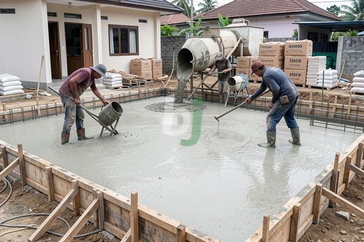

**Ngecor Rumah Praktis Tanpa Salah Perhitungan Biaya di Jabodetabek** - Hai Mitra Beton Jago! Mau membangun rumah impian atau merenovasi di Jabodetabek? Salah satu tahap penting yang sering bikin pusing adalah pengecoran. Nah, jangan khawatir! Kami akan kupas tuntas cara ngecor rumah yang praktis, efisien, dan tentu saja, tanpa salah perhitungan biaya. Yuk, simak panduan lengkapnya!

## Memilih Beton yang Tepat untuk Kebutuhan Rumah Anda

Mitra Beton Jago, saat bicara soal beton, ada banyak pilihan yang tersedia. Memilih jenis yang tepat itu krusial, lho. Pada dasarnya, ada dua cara mendapatkan beton untuk proyek Anda: beton *ready mix* dan pencampuran manual.

Beton *ready mix* itu seperti pesan makanan instan: sudah dicampur dengan takaran presisi di pabrik, lalu langsung diantar ke lokasi proyek menggunakan *concrete pump*. Kelebihannya? Kualitas lebih terjamin, waktu lebih hemat, dan prosesnya jadi lebih ringkas. Kalau beton manual, Anda harus mencampur sendiri di lokasi. Butuh lebih banyak tenaga dan kontrol kualitas yang lebih ketat.

Untuk pondasi rumah, kami sarankan beton mutu K-250 atau K-300. Kekuatan mutu ini sudah cukup untuk menopang berat bangunan Anda. Sementara untuk lantai, beton mutu K-225 biasanya sudah memadai. Perlu diingat, angka mutu ini menunjukkan seberapa kuat beton menahan tekanan (kg/cm²). Semakin tinggi angkanya, semakin kuat betonnya.

## Menghitung Volume Beton yang Anda Butuhkan – Akurat Itu Penting!

Supaya tidak boros atau malah kekurangan material, menghitung volume beton dengan tepat itu wajib hukumnya. Gimana caranya? Cukup kalikan luas area yang akan dicor dengan ketebalan cor yang direncanakan.

Misalnya, Anda mau ngecor lantai seluas 50 meter persegi dengan ketebalan 10 cm (0,1 meter). Maka, volume beton yang dibutuhkan adalah:

50 m² x 0,1 m = 5 m³

Tapi ingat, Mitra! Selalu ada sedikit kehilangan material saat pengecoran (tumpahan, porositas, dll.). Kami sarankan tambahkan sekitar 5-10% dari total hasil perhitungan sebagai cadangan. Jadi, dalam contoh tadi, sebaiknya pesan:

5 m³ + (5% x 5 m³) = 5,25 m³ atau
5 m³ + (10% x 5 m³) = 5,5 m³

## Estimasi Biaya Pengecoran Rumah di Jabodetabek – Biar Tidak Kaget!

Biaya pengecoran rumah itu bisa beda-beda, tergantung beberapa hal: jenis beton, volume beton, lokasi proyek, dan jasa pengecoran yang Anda pilih.  Harga beton *ready mix* di Jabodetabek bisa berkisar antara Rp 800.000 hingga Rp 1.200.000 per meter kubik.  Harga ini bisa berubah sewaktu-waktu, ya. Untuk penawaran yang lebih akurat sesuai kebutuhan proyek Anda, langsung saja hubungi tim Kami.

Selain harga beton, jangan lupa juga memperhitungkan biaya tambahan seperti sewa *concrete pump*, upah tenaga kerja, dan biaya bekisting. Sewa *concrete pump* biasanya berkisar antara Rp 500.000 hingga Rp 1.500.000 per hari, tergantung kapasitas dan durasi pemakaian. Biaya tenaga kerja juga bervariasi tergantung UMR di wilayah Anda. [Biaya Ngecor Rumah: Rincian Lengkap dan Estimasi 2026](/blog/biaya-ngecor-rumah/) bisa jadi referensi tambahan yang bermanfaat.

## Tips Sukses Ngecor Rumah – Mulus Sampai Selesai!

Supaya proses ngecor rumah Mitra berjalan lancar dan hasilnya maksimal, perhatikan tips berikut ini:

*   **Bekisting yang Kuat:** Pastikan bekisting dalam kondisi kokoh dan kuat menahan beban beton. Cek juga sambungannya supaya tidak bocor.
*   **Pemadatan Sempurna:** Gunakan vibrator untuk memadatkan beton secara merata. Ini penting untuk menghilangkan gelembung udara dan memastikan beton terisi penuh dalam bekisting.
*   **Perawatan Beton yang Benar:** Setelah cor selesai, tutup permukaan beton dengan karung goni basah atau plastik selama minimal 7 hari. Ini mencegah penguapan air terlalu cepat dan membantu beton mengeras dengan sempurna.  Angin2 Rumah Cor: Penyebab, Dampak, dan Cara Mengatasi Retak pada Struktur Beton menjelaskan lebih detail tentang perawatan beton.
*   **Pilih Mitra yang Terpercaya:** Gunakan jasa penyedia beton *ready mix* dan jasa pengecoran yang berpengalaman dan terpercaya. Beton Jago siap menjadi mitra terbaik Anda di Jabodetabek!

Jangan ragu untuk menghubungi tim Kami melalui tombol **Telepon** atau **WhatsApp** yang tersedia di bawah. Kami siap membantu mewujudkan proyek impian Mitra Beton Jago di Jabodetabek. [Cara Ngecor Dak yang Sering Salah dan Biaya Beton Jago Jabodetabek](/blog/cara-ngecor-dak/) juga bisa menjadi bacaan tambahan yang menarik.