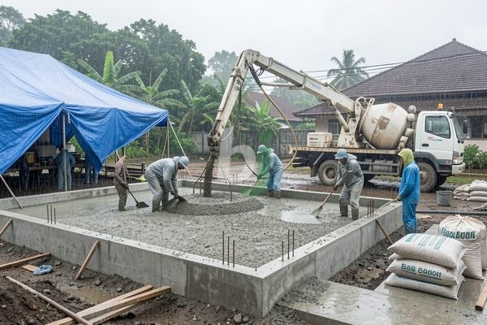

**Seluk-Beluk Ngecor Rumah Saat Hujan Agar Struktur Tetap Kuat** - Mitra Beton Jago dimana saja berada, pengecoran merupakan tahap krusial dalam konstruksi bangunan. Namun, apa yang terjadi jika hujan turun saat Anda berencana melakukan pengecoran?

Pengecoran saat musim hujan memang memerlukan perhatian ekstra. Anda perlu memahami potensi risiko dan menerapkan langkah-langkah pencegahan agar kualitas beton tidak terganggu. Kami akan membahas secara mendalam mengenai hal ini.

## Risiko Mengecor Rumah Saat Hujan

Hujan dapat memengaruhi kualitas beton yang dicor melalui beberapa cara. Air hujan yang bercampur dengan adonan beton dapat menurunkan kekuatan dan durabilitas material. Hal ini terjadi karena air hujan mengandung kotoran dan polutan yang dapat bereaksi dengan semen, mengganggu proses hidrasi yang ideal.

Selain itu, curah hujan tinggi dapat menyebabkan air permukaan menggenang di area pengecoran. Kondisi ini dapat merusak permukaan beton yang baru dicor, menyebabkan retak rambut atau bahkan pengelupasan. Perlu diingat, proses pengerasan beton membutuhkan kelembapan yang stabil, bukan kelebihan air yang mendadak.

## Persiapan Penting Sebelum Melakukan Pengecoran Saat Hujan

Persiapan yang matang menjadi kunci keberhasilan pengecoran saat hujan. Pertama, pantau terus prakiraan cuaca. Hindari melakukan pengecoran jika hujan deras diperkirakan akan berlangsung lama. Jika hujan ringan atau gerimis, Anda masih dapat melanjutkan pekerjaan dengan beberapa tindakan pencegahan.

Pastikan area pengecoran tertutup dengan terpal atau tenda kedap air. Tujuannya adalah melindungi adonan beton dari kontak langsung dengan air hujan. Selain itu, persiapkan juga material pendukung seperti pasir urug untuk mengantisipasi genangan air di sekitar area cor.

## Teknik Pengecoran yang Tepat Saat Hujan

Setelah persiapan dilakukan, teknik pengecoran yang benar juga sangat penting. Gunakan campuran beton *waterproofing* untuk meningkatkan ketahanan beton terhadap air. Pastikan rasio campuran air dan semen sesuai dengan rekomendasi standar SNI, yaitu sekitar 0,4 hingga 0,5.

Selama proses pengecoran, usahakan agar hujan tidak mengenai beton yang baru dituang. Jika terpaksa, gunakan alat pengering atau blower untuk mengeringkan permukaan beton secara berkala. Perhatikan pula kecepatan pengecoran; jangan terlalu lambat, namun juga jangan terburu-buru. Kecepatan yang ideal akan meminimalkan paparan beton terhadap air hujan.

## Perawatan Beton Setelah Pengecoran Saat Hujan

Perawatan beton setelah pengecoran sangat krusial, terutama jika pengecoran dilakukan saat hujan. Lakukan *curing* beton dengan menutup permukaan beton dengan terpal atau karung basah selama minimal 7 hari. Ini membantu menjaga kelembapan beton dan mencegah retak akibat penguapan air yang terlalu cepat.

Perhatikan juga drainase di sekitar area cor. Pastikan air hujan dapat mengalir dengan lancar untuk mencegah genangan yang dapat merusak beton. Jika terdapat retak rambut, segera lakukan perbaikan dengan menggunakan material *epoxy* atau semen khusus.

Sebagai tambahan, perlu diketahui bahwa harga beton *waterproofing* biasanya sedikit lebih tinggi dibandingkan beton biasa. Namun, investasi ini sebanding dengan kualitas dan ketahanan beton yang dihasilkan. Harga ini bersifat estimasi dan dapat berubah sewaktu-waktu — hubungi Kami untuk penawaran terbaru dan paling akurat sesuai kebutuhan proyek Anda.

Tim Kami siap membantu mewujudkan proyek Anda — silakan hubungi melalui tombol **Telepon** atau **WhatsApp** yang tersedia di bawah.
