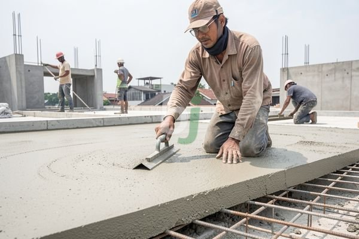

**Kenapa Pengganti Cor Dak Lebih Ringan dan Ekonomis** - Mitra Beton Jago di mana pun berada, mari kita bahas solusi inovatif untuk konstruksi dak.

Dak cor konvensional telah lama menjadi standar dalam konstruksi bangunan. Namun, ada kalanya Anda membutuhkan alternatif yang lebih ringan, lebih cepat dipasang, atau lebih ekonomis. Anda mungkin sedang mempertimbangkan renovasi bangunan yang sudah ada atau membangun struktur baru dengan mempertimbangkan efisiensi biaya dan waktu. Kami akan mengulas berbagai material pengganti cor dak yang tersedia saat ini.

## Material Pengganti Cor Dak yang Populer

Ada beberapa opsi material yang dapat Anda pertimbangkan sebagai pengganti cor dak tradisional. Setiap material memiliki kelebihan dan kekurangan masing-masing, tergantung pada kebutuhan spesifik proyek Anda. Beberapa opsi yang paling umum meliputi:

*   **Dak Ringan (Lightweight Concrete):** Dak ringan menggunakan campuran semen, pasir, dan bahan ringan seperti expanded polystyrene (EPS) atau perlite. Material ini lebih ringan dari beton konvensional, mengurangi beban pada struktur bangunan.
*   **Dak Spandrel:** Sistem dak spandrel menggunakan panel precast yang dipasang di atas balok baja atau beton. Panel ini biasanya terbuat dari beton ringan atau material komposit.
*   **Dak Baja Ringan:** Struktur dak baja ringan terdiri dari rangka baja ringan yang dilapisi dengan material penutup seperti genteng metal atau sandwich panel.
*   **Dak Kayu:** Meskipun kurang umum untuk bangunan modern, dak kayu tetap menjadi pilihan yang menarik untuk desain tertentu, terutama yang mengutamakan estetika dan karakteristik alami.

## Keunggulan dan Kekurangan Masing-Masing Material

Setiap material pengganti cor dak memiliki karakteristik unik yang perlu dipertimbangkan secara matang. Berikut adalah perbandingan singkat untuk membantu Anda dalam pengambilan keputusan:

| Material          | Keunggulan                               | Kekurangan                               |
|-------------------|------------------------------------------|------------------------------------------|
| Dak Ringan        | Lebih ringan, hemat biaya, isolasi termal | Kurang kuat dibandingkan beton konvensional |
| Dak Spandrel      | Pemasangan cepat, presisi tinggi          | Membutuhkan perhitungan yang akurat       |
| Dak Baja Ringan   | Kuat, tahan lama, ringan                 | Membutuhkan perlindungan anti karat       |
| Dak Kayu          | Estetis, ramah lingkungan                 | Perawatan intensif, rentan terhadap hama |

Sebagai contoh, jika Anda memiliki anggaran terbatas dan membutuhkan solusi yang ringan, dak ringan mungkin menjadi pilihan terbaik. Namun, jika kekuatan dan daya tahan menjadi prioritas utama, dak baja ringan atau dak spandrel mungkin lebih sesuai. Perlu diingat bahwa estimasi biaya dak ringan per meter persegi dapat bervariasi tergantung pada ketebalan dan jenis bahan ringan yang digunakan. Harga ini bersifat estimasi dan dapat berubah sewaktu-waktu — hubungi Kami untuk penawaran terbaru dan paling akurat sesuai kebutuhan proyek Anda.

## Pertimbangan Teknis dalam Pemilihan Material

Pemilihan material pengganti cor dak tidak hanya didasarkan pada anggaran dan preferensi estetika. Beberapa faktor teknis perlu dipertimbangkan untuk memastikan keamanan dan keberlanjutan struktur bangunan Anda.

*   **Beban:** Perhitungkan beban mati (berat material bangunan) dan beban hidup (beban akibat aktivitas manusia dan perabotan).
*   **Rentang:** Panjang bentang dak akan mempengaruhi pemilihan material dan desain struktur.
*   **Kemampuan Menahan Api:** Pastikan material yang dipilih memiliki ketahanan api yang memadai.
*   **Isolasi Termal dan Akustik:** Pertimbangkan kebutuhan isolasi termal dan akustik untuk kenyamanan penghuni.
*   **Sistem Drainase:** Rencanakan sistem drainase yang efektif untuk mencegah genangan air di atas dak.

## Aplikasi dan Contoh Kasus Penggunaan

Beberapa proyek telah berhasil menerapkan material pengganti cor dak dengan hasil yang memuaskan. Misalnya, penggunaan dak ringan pada renovasi rumah tinggal dapat mengurangi beban struktur secara signifikan, sehingga tidak perlu memperkuat pondasi yang sudah ada. Sementara itu, dak baja ringan sering digunakan pada bangunan komersial atau gudang karena kemampuannya menahan beban berat dan rentang yang luas.

Untuk konsultasi lebih lanjut, tombol **Telepon** dan **WhatsApp** di bawah halaman ini dapat langsung digunakan untuk menghubungi Kami.
