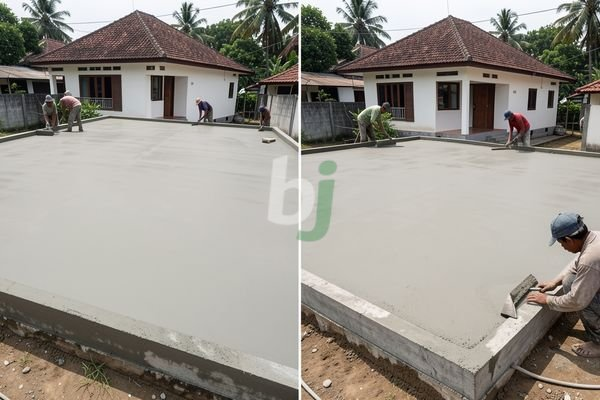

**Perbandingan Cor Dak** - Mitra Beton Jago yang budiman, pernahkah Anda bertanya-tanya, metode cor dak mana yang paling sesuai untuk kebutuhan konstruksi Anda?

Memilih metode cor dak yang tepat merupakan keputusan penting dalam setiap proyek pembangunan. Ada beragam opsi yang tersedia, masing-masing dengan kelebihan dan kekurangannya sendiri. Artikel ini akan membahas perbandingan berbagai metode cor dak yang umum digunakan, membantu Anda memahami implikasi biaya, kekuatan, dan efisiensi dari setiap pilihan. Dengan pemahaman yang komprehensif, Anda dapat membuat keputusan yang tepat dan memastikan proyek Anda berjalan lancar dan sesuai anggaran.

## Metode Cor Dak Konvensional: Keandalan yang Teruji Waktu

Metode cor dak konvensional, atau *in-situ*, merupakan cara tradisional dalam membangun dak beton. Prosesnya melibatkan pembuatan bekisting (cetakan) di lokasi proyek, pemasangan tulangan baja, dan kemudian menuangkan campuran beton segar ke dalam bekisting tersebut. Metode ini masih banyak digunakan karena relatif sederhana dan tidak memerlukan peralatan khusus yang mahal.

Kekuatan utama dari metode konvensional terletak pada fleksibilitas desainnya. Anda dapat menyesuaikan bentuk dan ukuran dak sesuai dengan kebutuhan spesifik proyek Anda. Selain itu, metode ini juga relatif mudah dikerjakan oleh tenaga kerja lokal yang terampil. Namun, ada beberapa kelemahan yang perlu dipertimbangkan. Proses pengerjaan yang relatif lambat, ketergantungan pada cuaca, dan potensi limbah material adalah beberapa tantangan yang mungkin dihadapi.

Sebagai gambaran, biaya untuk cor dak konvensional biasanya berkisar antara Rp 800.000 hingga Rp 1.200.000 per meter persegi, tergantung pada ketebalan dak, mutu beton yang digunakan (misalnya K-250, K-300), dan lokasi proyek. Harga ini bersifat estimasi dan dapat berubah sewaktu-waktu — hubungi Kami untuk penawaran terbaru dan paling akurat sesuai kebutuhan proyek Anda.

## Dak Precast: Efisiensi dan Kecepatan Pengerjaan

Sebagai alternatif dari metode konvensional, dak *precast* (pracetak) menawarkan solusi yang lebih efisien dan cepat. Dak precast diproduksi di pabrik dengan kontrol kualitas yang ketat, kemudian diangkut ke lokasi proyek dan dipasang menggunakan crane. Metode ini sangat cocok untuk proyek yang membutuhkan waktu pengerjaan yang singkat dan presisi tinggi.

Keunggulan utama dak precast adalah efisiensi waktu dan biaya. Proses produksi yang terkontrol di pabrik menghasilkan kualitas yang lebih konsisten dan mengurangi risiko kesalahan konstruksi. Selain itu, dak precast juga menghasilkan lebih sedikit limbah material dibandingkan metode konvensional. Namun, ada beberapa batasan yang perlu diperhatikan. Desain dak precast cenderung lebih standar dan kurang fleksibel dibandingkan metode konvensional. Transportasi dan pemasangan dak precast juga memerlukan perencanaan yang matang dan peralatan khusus.

Untuk perbandingan biaya, harga dak precast biasanya berkisar antara Rp 900.000 hingga Rp 1.400.000 per meter persegi, tergantung pada ukuran, ketebalan, dan desain dak. Harga ini bersifat estimasi dan dapat berubah sewaktu-waktu — hubungi Kami untuk penawaran terbaru dan paling akurat sesuai kebutuhan proyek Anda.

## Perbandingan Biaya dan Waktu Pengerjaan: Cor Dak Konvensional vs. Precast

Untuk memberikan gambaran yang lebih jelas, berikut adalah tabel perbandingan biaya dan waktu pengerjaan antara metode cor dak konvensional dan precast:

<table class="table">
  <caption>Perbandingan Cor Dak Konvensional vs. Precast</caption>
  <thead>
    <tr><th>Aspek</th><th>Cor Dak Konvensional</th><th>Dak Precast</th></tr>
  </thead>
  <tbody>
    <tr><td>Biaya per m² (Estimasi)</td><td>Rp 800.000 - Rp 1.200.000</td><td>Rp 900.000 - Rp 1.400.000</td></tr>
    <tr><td>Waktu Pengerjaan (per m²)</td><td>3 - 7 hari</td><td>1 - 3 hari</td></tr>
    <tr><td>Fleksibilitas Desain</td><td>Tinggi</td><td>Terbatas</td></tr>
    <tr><td>Kualitas</td><td>Tergantung Kualitas Pekerjaan</td><td>Konsisten &amp; Terkontrol</td></tr>
    <tr><td>Limbah Material</td><td>Relatif Tinggi</td><td>Relatif Rendah</td></tr>
  </tbody>
</table>

Perlu diingat bahwa angka-angka di atas hanyalah estimasi dan dapat bervariasi tergantung pada kompleksitas proyek, lokasi, dan spesifikasi material yang digunakan.

## Faktor-Faktor Penentu Pemilihan Metode Cor Dak

Selain biaya dan waktu pengerjaan, ada beberapa faktor lain yang perlu Anda pertimbangkan saat memilih metode cor dak yang tepat. Faktor-faktor tersebut meliputi:

*   **Kondisi Lokasi:** Aksesibilitas lokasi proyek dapat mempengaruhi pilihan metode. Dak precast memerlukan ruang yang cukup untuk penyimpanan dan pemasangan.
*   **Desain Arsitektur:** Jika desain bangunan memerlukan bentuk dak yang kompleks dan unik, metode konvensional mungkin menjadi pilihan yang lebih baik.
*   **Ketersediaan Tenaga Kerja:** Metode konvensional membutuhkan tenaga kerja yang terampil dalam pemasangan bekisting dan tulangan baja.
*   **Anggaran Proyek:** Biaya merupakan faktor penting yang perlu dipertimbangkan. Anda perlu membandingkan biaya total dari masing-masing metode, termasuk biaya material, tenaga kerja, dan peralatan.

Kami memahami bahwa memilih metode cor dak yang tepat dapat menjadi tantangan. Kami siap membantu Anda mengevaluasi kebutuhan proyek Anda dan memberikan rekomendasi yang paling sesuai.

Tim Kami siap membantu mewujudkan proyek Anda — silakan hubungi melalui tombol **Telepon** atau **WhatsApp** yang tersedia di bawah.
