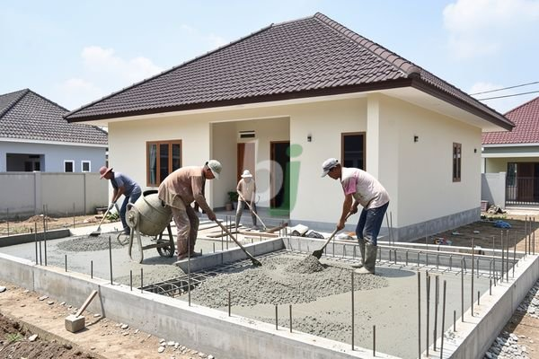

**Perkiraan biaya dak rumah untuk pemilik rumah dan kontraktor** - Hai Mitra Beton Jago! Punya rencana membangun atau merenovasi dak rumah di (not detected)? Nah, biaya dak rumah seringkali jadi perhatian utama, ya kan? Artikel ini akan membahas secara detail perkiraan biaya, faktor-faktor yang mempengaruhinya, serta tips cerdas untuk mengelola anggaran proyek Anda. Kami akan bantu Anda memahami seluk-beluk biaya dak rumah agar perencanaan proyek lebih matang.

## Apa Saja yang Mempengaruhi Biaya Dak Rumah?

Yuk, kita bedah bersama apa saja elemen penting yang bikin biaya pembuatan dak rumah bisa naik turun. Memahami ini penting banget supaya anggaran Anda lebih realistis.

Pertama, tentu saja luas area yang akan dicor. Semakin luas dak Anda, semakin banyak material yang dibutuhkan. Kedua, jenis beton yang dipilih punya pengaruh besar. Beton dengan mutu lebih tinggi, seperti K-300 atau K-350, jelas akan lebih mahal daripada mutu standar. Ketiga, ketebalan dak juga ikut menentukan volume material yang digunakan. Biasanya, ketebalan dak berkisar antara 120 mm hingga 150 mm, disesuaikan dengan bentang dan beban yang akan ditanggung.

Selain itu, jangan lupakan biaya tenaga kerja. Upah tukang cor di (not detected) bervariasi, tergantung lokasi dan pengalaman mereka. Terakhir, ada biaya tambahan yang seringkali terlewat, seperti ongkos transportasi material, sewa alat jika diperlukan, dan biaya pembuangan sisa material. Pastikan semua itu masuk dalam perhitungan Anda, ya.

## Simulasi Biaya Dak Rumah: Contoh Kasus di (not detected)

Mari kita coba hitung estimasi biaya dak rumah dengan luas 60 meter persegi dan ketebalan 120 mm (0,12 meter). Asumsikan harga beton readymix K-300 adalah Rp 1.400.000 per meter kubik (harga ini bersifat estimasi dan bisa berubah sewaktu-waktu — hubungi Kami untuk penawaran terbaru dan paling akurat sesuai kebutuhan proyek Anda).

Volume beton yang dibutuhkan: 60 m² x 0,12 m = 7,2 m³

Biaya beton: 7,2 m³ x Rp 1.400.000/m³ = Rp 10.080.000

Selanjutnya, kita hitung biaya besi beton (rebar). Kebutuhan besi beton tergantung desain struktur, tapi biasanya berkisar antara 80-120 kg per meter kubik beton. Kita ambil angka tengah, yaitu 100 kg/m³.

Total besi beton yang dibutuhkan: 7,2 m³ x 100 kg/m³ = 720 kg

Dengan asumsi harga besi beton Rp 15.000 per kilogram, maka:

Biaya besi beton: 720 kg x Rp 15.000/kg = Rp 10.800.000

Biaya tenaga kerja biasanya dihitung per meter persegi atau per meter kubik. Anggap saja biaya tenaga kerja adalah Rp 200.000 per meter persegi.

Biaya tenaga kerja: 60 m² x Rp 200.000/m² = Rp 12.000.000

Jadi, total estimasi biaya: Rp 10.080.000 (beton) + Rp 10.800.000 (besi) + Rp 12.000.000 (tenaga kerja) = Rp 32.880.000

Ingat, ini hanya estimasi kasar. Biaya riil bisa berbeda tergantung kondisi lapangan dan negosiasi harga.

## Pilih Jasa Pengecoran dan Beton Readymix yang Tepat di (not detected)

Memilih jasa pengecoran dan penyedia material yang handal itu penting banget. Pastikan mereka punya pengalaman dan reputasi baik. Coba tanya rekomendasi dari teman atau kenalan yang pernah pakai jasanya.

Soal kualitas beton, jangan sembarangan pilih! Pastikan beton readymix yang digunakan sudah teruji dan memenuhi standar SNI. Sebagai penyedia beton readymix terpercaya di Jabodetabek, termasuk (not detected), kami menjamin kualitas produk dan harga yang kompetitif. Anda bisa mengandalkan Beton Jago untuk hasil pengecoran yang kuat dan tahan lama.

## Tips Jitu Menghemat Biaya Dak Rumah Anda

Mau hemat biaya dak rumah? Ada beberapa trik yang bisa dicoba, lho. Pertama, desain struktur yang efisien bisa mengurangi kebutuhan material. Kedua, bandingkan harga dari beberapa penyedia material dan jasa pengecoran untuk dapat penawaran terbaik. Ketiga, jangan lewatkan promo atau diskon menarik. Keempat, usahakan meminimalkan sisa material dengan perencanaan yang matang.

Untuk informasi lebih lanjut atau konsultasi gratis, jangan ragu menghubungi Kami. Tombol **Telepon** dan **WhatsApp** di bawah halaman ini siap membantu Anda. Jangan tunda lagi, yuk wujudkan dak rumah impian Anda dengan Beton Jago! [Biaya Borongan Dak Rumah Per Meter: Estimasi 2026 dan Faktor Penentu](/blog/biaya-borongan-dak-rumah-per-meter/) [Biaya Buat Dak Rumah: Rincian Lengkap dan Estimasi 2026](/blog/biaya-buat-dak-rumah/)