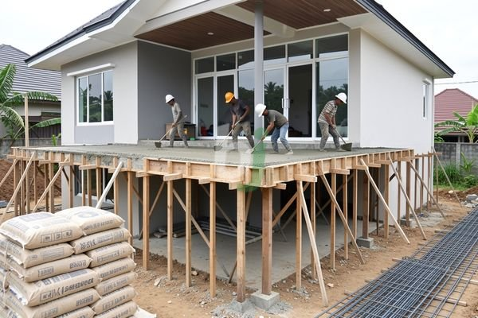

**Rumah Full Cor Beton Jago, Kelebihan Biaya dan Cara Mengatasi Retak** - Mitra Beton Jago yang terhormat, rumah *full cor* atau rumah beton bertulang adalah solusi konstruksi yang semakin populer di Indonesia. Konsep ini melibatkan pengecoran beton secara menyeluruh pada struktur bangunan, mulai dari pondasi, kolom, balok, hingga lantai dan atap. Dengan demikian, rumah memiliki kekuatan dan ketahanan yang optimal terhadap berbagai kondisi lingkungan dan bencana alam.

## Keunggulan Rumah Full Cor Dibandingkan Sistem Konstruksi Lain

Mitra Beton Jago akan menemukan bahwa rumah *full cor* memiliki sejumlah keunggulan signifikan dibandingkan dengan sistem konstruksi tradisional seperti bata merah atau kayu. Keunggulan utama terletak pada kekuatan struktural yang superior. Beton memiliki daya tahan yang tinggi terhadap tekanan, benturan, dan perubahan cuaca ekstrem. Hal ini menjadikan rumah lebih aman dan tahan lama, terutama di wilayah yang rawan gempa bumi atau banjir.

Selain kekuatan, rumah *full cor* juga menawarkan kenyamanan termal dan akustik yang lebih baik. Beton memiliki sifat insulasi yang baik, sehingga mampu menjaga suhu ruangan tetap stabil dan mengurangi kebisingan dari luar. Secara estetika, rumah *full cor* dapat didesain dengan lebih fleksibel dan modern, memberikan Mitra kebebasan untuk mewujudkan desain impian.

## Estimasi Biaya dan Faktor yang Mempengaruhi Biaya Pengecoran Rumah Full Cor

Biaya pengecoran rumah *full cor* bervariasi tergantung pada beberapa faktor, seperti luas bangunan, desain arsitektur, mutu beton yang digunakan, dan lokasi proyek. Sebagai gambaran, biaya cor rumah per meter persegi di Jabodetabek pada tahun 2026 berkisar antara Rp 3.500.000 hingga Rp 5.000.000. Harga ini bersifat estimasi dan dapat berubah sewaktu-waktu — hubungi Kami untuk penawaran terbaru dan paling akurat sesuai kebutuhan proyek Mitra Beton Jago.

Faktor-faktor lain yang memengaruhi biaya meliputi:

*   **Mutu Beton:** Semakin tinggi mutu beton (misalnya K-300, K-400), semakin mahal harganya.
*   **Harga Material:** Fluktuasi harga material seperti semen, pasir, dan batu split dapat memengaruhi total biaya.
*   **Upah Tukang:** Upah tukang cor juga bervariasi tergantung pada lokasi dan tingkat keahlian mereka.
*   **Akses Lokasi:** Jika lokasi proyek sulit dijangkau, biaya pengiriman material dan mobilisasi tenaga kerja akan lebih tinggi.

## Tips Pengerjaan Rumah Full Cor Agar Kuat dan Tahan Lama

Pengerjaan rumah *full cor* memerlukan perencanaan yang matang dan pelaksanaan yang tepat. Kami menyarankan beberapa tips berikut agar rumah Mitra Beton Jago kuat dan tahan lama:

*   **Perencanaan Struktur:** Libatkan ahli struktur untuk merancang struktur bangunan yang sesuai dengan kondisi tanah dan beban yang akan ditanggung.
*   **Pemilihan Material:** Gunakan material berkualitas tinggi dan sesuai dengan standar SNI. Pastikan mutu beton yang digunakan sesuai dengan rekomendasi ahli struktur.
*   **Proses Pengecoran:** Lakukan proses pengecoran secara bertahap dan merata. Hindari pengecoran langsung dalam waktu yang lama, karena dapat menyebabkan retak pada beton.
*   **Perawatan Beton:** Lakukan perawatan beton dengan baik setelah pengecoran, misalnya dengan menyiram air secara berkala selama 7-14 hari untuk mencegah retak akibat pengeringan yang terlalu cepat.

## Mengatasi Masalah Retak Pada Rumah Full Cor

Meskipun rumah *full cor* dikenal kuat dan tahan lama, tetap ada potensi terjadinya retak pada struktur beton. Retak dapat disebabkan oleh berbagai faktor, seperti penyusutan beton, beban berlebih, atau kesalahan dalam proses pengecoran. Jika Mitra Beton Jago menemukan retak pada rumah *full cor*, segera lakukan perbaikan untuk mencegah kerusakan yang lebih parah.

Untuk informasi lebih lanjut mengenai penyebab retak pada struktur beton dan cara mengatasinya, Mitra dapat membaca artikel kami tentang [Angin2 Rumah Cor: Penyebab, Dampak, dan Cara Mengatasi Retak pada Struktur Beton](/blog/angin2-rumah-cor/).

Tim Kami siap membantu mewujudkan proyek Mitra Beton Jago — silakan hubungi melalui tombol **Telepon** atau **WhatsApp** yang tersedia di bawah.
