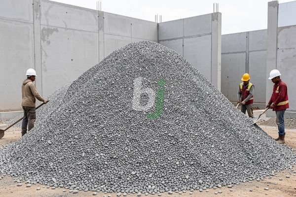

**Memahami Pengaruh Ukuran Batu Split untuk Cor Rumah** - Mitra Beton Jago dimana saja berada, pemilihan ukuran batu split yang tepat adalah kunci utama untuk menghasilkan campuran beton yang kuat dan tahan lama untuk struktur rumah Anda. Ukuran agregat kasar ini secara signifikan memengaruhi workabilitas, kekuatan tekan, dan durabilitas beton.

### Mengapa Ukuran Batu Split Penting?

Ukuran batu split, atau agregat kasar, dalam campuran beton tidak hanya mempengaruhi kekuatan struktural, tetapi juga volume material yang dibutuhkan dan biaya keseluruhan proyek. Batu split yang terlalu besar dapat membuat campuran sulit dikerjakan dan menghasilkan beton yang kurang padat. Sebaliknya, batu split yang terlalu kecil dapat meningkatkan kebutuhan semen dan air, meningkatkan biaya tanpa peningkatan kekuatan yang signifikan. Kami akan membahas berbagai ukuran yang tersedia dan bagaimana memilih yang paling sesuai untuk kebutuhan spesifik proyek Anda.

## Ukuran Batu Split yang Umum Digunakan

Ada beberapa ukuran batu split yang umum digunakan dalam konstruksi, masing-masing dengan karakteristik dan aplikasi yang berbeda. Pemahaman mengenai variasi ini akan membantu Anda membuat keputusan yang tepat.

*   **Ukuran 5/20 mm:** Ukuran ini adalah yang paling populer dan serbaguna untuk berbagai aplikasi cor rumah. Kombinasi antara batu yang lebih kecil dan lebih besar menghasilkan kepadatan yang baik dan workabilitas yang memadai.
*   **Ukuran 20/40 mm:** Ukuran ini cocok untuk fondasi, kolom, dan balok yang membutuhkan kekuatan yang lebih besar. Batu split yang lebih besar memberikan kekuatan tekan yang lebih tinggi.
*   **Ukuran 40/60 mm:** Digunakan terutama untuk pekerjaan infrastruktur berat atau pondasi bangunan bertingkat. Ukuran ini jarang digunakan untuk cor rumah biasa karena membutuhkan peralatan khusus untuk penanganan.

### Mempertimbangkan Aplikasi dalam Proyek Anda

Pilihan ukuran batu split harus disesuaikan dengan aplikasi spesifik dalam proyek cor rumah Anda. Fondasi dan struktur penahan beban membutuhkan batu split yang lebih besar untuk kekuatan yang lebih tinggi, sementara lantai dan area yang membutuhkan workabilitas yang lebih baik mungkin lebih cocok dengan ukuran yang lebih kecil.

Sebagai contoh, untuk fondasi rumah dua lantai, batu split ukuran 20/40 mm akan memberikan kekuatan yang cukup untuk menahan beban bangunan. Namun, untuk lantai atau area parkir, ukuran 5/20 mm akan memberikan hasil yang lebih baik dalam hal kemudahan pengerjaan dan finishing.

## Perbandingan Ukuran Batu Split dan Aplikasinya

Berikut adalah tabel yang merangkum perbandingan ukuran batu split yang umum digunakan beserta aplikasinya:

<table class="table">
  <caption>Perbandingan Ukuran Batu Split</caption>
  <thead>
    <tr><th>Ukuran (mm)</th><th>Kekuatan Tekan</th><th>Workabilitas</th><th>Aplikasi Umum</th></tr>
  </thead>
  <tbody>
    <tr><td>5/20</td><td>Sedang</td><td>Baik</td><td>Lantai, trotoar, jalan setapak</td></tr>
    <tr><td>20/40</td><td>Tinggi</td><td>Cukup</td><td>Fondasi, kolom, balok</td></tr>
    <tr><td>40/60</td><td>Sangat Tinggi</td><td>Buruk</td><td>Pondasi bangunan bertingkat, infrastruktur berat</td></tr>
  </tbody>
</table>

### Tips Tambahan dalam Memilih Batu Split

Selain ukuran, perhatikan juga kualitas batu split yang Anda beli. Pastikan batu split tersebut bersih dari kotoran, lumpur, dan material organik yang dapat mengurangi kekuatan beton. Pilih batu split yang memiliki bentuk yang kubus atau mendekati kubus untuk memastikan kepadatan maksimum dalam campuran beton.

Untuk proyek yang lebih kompleks, kami sarankan untuk berkonsultasi dengan ahli konstruksi atau insinyur sipil untuk mendapatkan rekomendasi ukuran batu split yang paling sesuai dengan kebutuhan proyek Anda. Anda juga dapat mempertimbangkan untuk menggunakan beton *ready mix* yang telah diformulasikan secara optimal untuk memastikan kualitas dan kekuatan yang konsisten.

Kesimpulannya, pemilihan ukuran batu split yang tepat adalah faktor penting dalam keberhasilan proyek cor rumah Anda. Dengan mempertimbangkan aplikasi spesifik, kekuatan yang dibutuhkan, dan kualitas material, Anda dapat memastikan bahwa beton yang dihasilkan kuat, tahan lama, dan memenuhi standar kualitas yang diharapkan. Jangan ragu untuk berkonsultasi dengan profesional jika Anda memerlukan bantuan dalam menentukan ukuran yang paling tepat untuk proyek Anda.

Tim Kami siap membantu mewujudkan proyek Anda — silakan hubungi melalui tombol **Telepon** atau **WhatsApp** yang tersedia di bawah.
