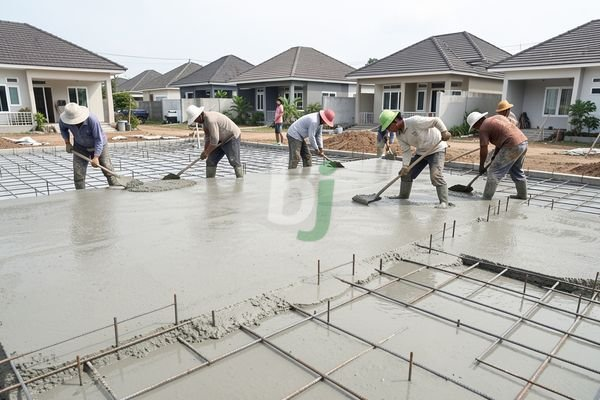

**Ukuran Cor Dak untuk Bangunan Kuat dan Akurat** - Mitra Beton Jago yang terhormat, pernahkah Anda bertanya-tanya seberapa tebal idealnya dak beton untuk bangunan Anda?

Dak beton adalah elemen vital dalam konstruksi bangunan, berfungsi sebagai penutup atas dan penahan beban. Memilih ukuran cor dak yang tepat bukan hanya tentang kekuatan struktural, tetapi juga efisiensi biaya dan keamanan jangka panjang. Kami akan membahas secara mendalam mengenai standar ukuran cor dak yang berlaku, bagaimana menghitung volume yang dibutuhkan, serta faktor-faktor penting yang perlu Anda pertimbangkan.

## Standar Ukuran dan Ketebalan Cor Dak

Ketebalan cor dak yang direkomendasikan bervariasi tergantung pada beberapa faktor, termasuk bentang (jarak antara penyangga), beban yang akan ditahan, dan jenis penggunaan bangunan. Secara umum, ketebalan minimum yang sering digunakan adalah 10 cm, namun ini tidak selalu cukup untuk semua kondisi. 

Untuk bangunan rumah tinggal dengan bentang normal (hingga 4 meter), ketebalan 12 cm hingga 15 cm seringkali sudah memadai. Namun, jika bentang lebih panjang, atau jika dak akan digunakan untuk area lalu lintas kendaraan atau beban berat lainnya, ketebalan harus ditingkatkan menjadi 15 cm hingga 20 cm atau bahkan lebih. Konsultasikan dengan ahli struktur untuk mendapatkan rekomendasi yang paling sesuai dengan kebutuhan proyek Anda.

Selain ketebalan, lebar dan panjang dak juga perlu diperhatikan. Ukuran ini akan menentukan volume beton yang dibutuhkan. Perlu diingat bahwa dimensi ini harus sesuai dengan perencanaan arsitektur dan struktur bangunan.

## Perhitungan Volume Cor Dak yang Akurat

Menghitung volume cor dak dengan akurat sangat penting untuk menghindari kekurangan atau kelebihan material. Rumus dasar untuk menghitung volume adalah:

**Volume = Panjang x Lebar x Ketebalan**

Sebagai contoh, mari kita hitung volume untuk dak dengan ukuran 6 meter x 4 meter dan ketebalan 12 cm (0,12 meter):

Volume = 6 m x 4 m x 0,12 m = 2,88 m³

Perhitungan ini memberikan volume teoritis. Dalam praktiknya, selalu tambahkan toleransi sekitar 5-10% untuk mengantisipasi kehilangan material saat pengecoran dan untuk memastikan cakupan yang memadai. Jadi, volume yang perlu dipesan adalah sekitar 2,88 m³ + (5% dari 2,88 m³) = 3,024 m³.

## Faktor-faktor yang Mempengaruhi Pemilihan Ukuran Cor Dak

Beberapa faktor penting perlu menjadi pertimbangan Anda ketika menentukan ukuran cor dak yang optimal. Salah satunya adalah mutu beton. Mutu beton yang lebih tinggi (misalnya K-300 atau K-350) biasanya memungkinkan penggunaan ketebalan yang lebih tipis dibandingkan dengan mutu beton yang lebih rendah.

![TABEL_MULAI]
{"title": "Perbandingan Mutu Beton dan Ketebalan Dak (Estimasi)", "headers": ["Mutu Beton", "Ketebalan Minimum (Bentang Normal)", "Kekuatan Tekan (MPa)"]}
{"row": ["K-250", "15 cm", "25"]}
{"row": ["K-300", "12 cm", "30"]}
{"row": ["K-350", "10 cm", "35"]}
[[TABEL_SELESAI]]

Faktor lain yang perlu diperhatikan adalah jarak antar tulangan. Jarak yang lebih rapat akan meningkatkan kekuatan dak, tetapi juga akan meningkatkan biaya material. Jenis tulangan yang digunakan juga berpengaruh. Tulangan baja dengan diameter yang lebih besar dan mutu yang lebih tinggi akan memberikan kekuatan yang lebih baik.

Selain itu, penting untuk memperhatikan perhitungan beban kerja dak. Beban ini mencakup beban mati (berat sendiri bangunan) dan beban hidup (beban yang ditimbulkan oleh aktivitas manusia, perabot, dan lain-lain). Perhitungan beban yang akurat akan membantu Anda menentukan ketebalan dak yang sesuai.

## Mengoptimalkan Biaya Cor Dak Anda

Harga material beton readymix dapat bervariasi tergantung pada lokasi, mutu beton, dan volume pemesanan. Harga ini bersifat estimasi dan dapat berubah sewaktu-waktu — hubungi Kami untuk penawaran terbaru dan paling akurat sesuai kebutuhan proyek Mitra Beton Jago.

Untuk mengoptimalkan biaya, pertimbangkan untuk menggunakan mutu beton yang sesuai dengan kebutuhan struktural. Hindari penggunaan mutu beton yang terlalu tinggi jika tidak diperlukan, karena hal ini akan meningkatkan biaya tanpa memberikan peningkatan kekuatan yang signifikan. Selain itu, bandingkan harga dari beberapa penyedia beton readymix untuk mendapatkan penawaran terbaik.

Apabila terdapat pertanyaan lain seputar topik ini, tombol **Telepon** dan **WhatsApp** di bawah halaman ini siap Kami jawab.
